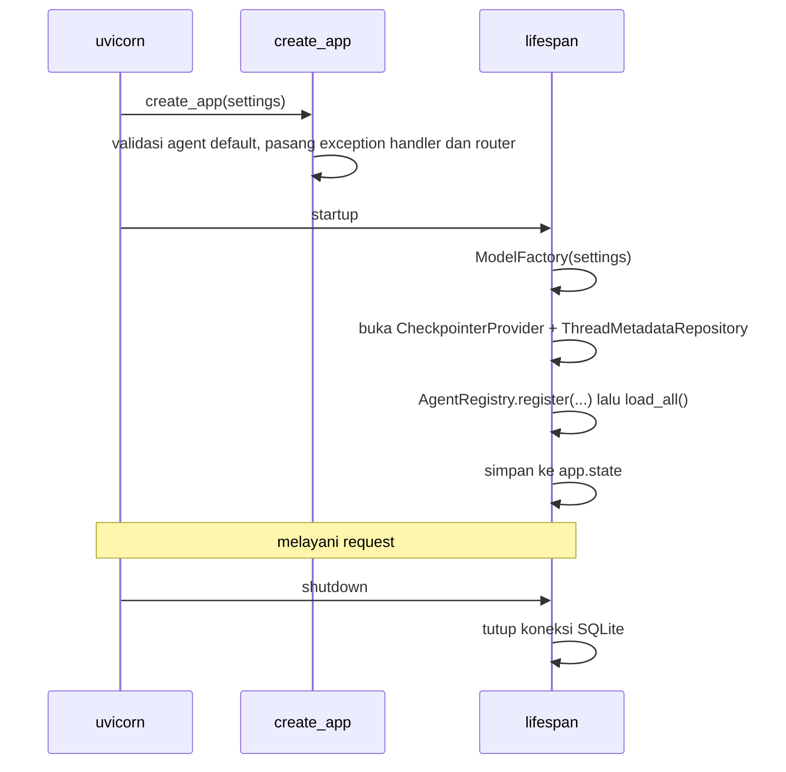
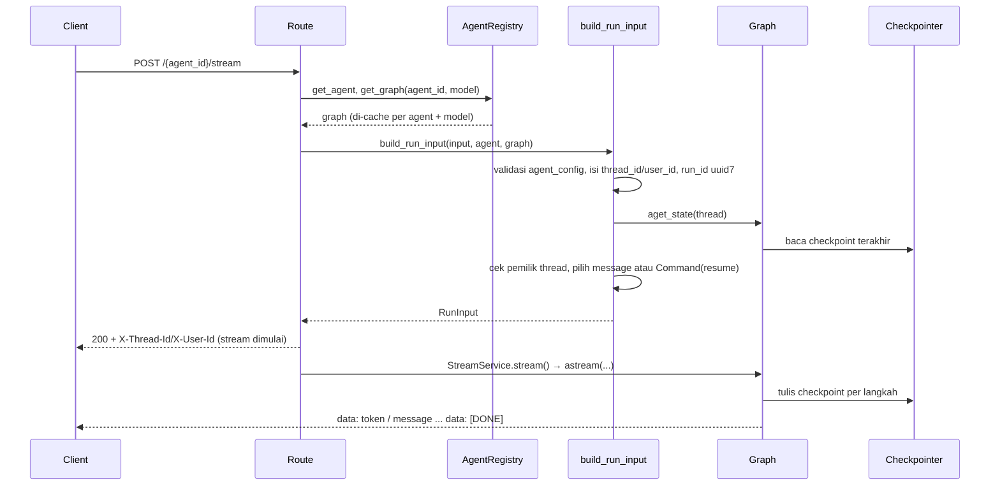

# Arsitektur

Dokumen ini menjelaskan bagaimana service bekerja dari startup sampai satu request selesai, dan
bagaimana menambah agent baru. Aturan menulis kode ada di [AGENTS.md](../AGENTS.md). Requirement dan
kontrak API ada di [PRD.md](../PRD.md).

## Gambaran Besar

Service ini membungkus graph LangGraph dengan API FastAPI. Satu proses berisi:

- **Registry agent.** Setiap agent dapat membangun graph untuk model mana pun yang diizinkan.
- **Satu file SQLite.** File ini menyimpan checkpoint percakapan dan judul custom thread.
- **Endpoint HTTP.** Ada endpoint untuk menjalankan agent (`/invoke`, `/stream`), membaca riwayat
  (`/history`), dan mengelola thread (`/threads`).

Client dan UI (M2) berkomunikasi dengan service hanya lewat HTTP, dengan schema dari
`agent_service.schema`.

## Layer

```text
src/agent_service/
├── core/      Settings, konstanta, configure_logging
├── llm/       ModelFactory, FakeModel
├── agents/    BaseAgent, AgentRegistry, catalog, ChatbotAgent, error agent
├── memory/    CheckpointerProvider, ThreadMetadataRepository (SQLite)
├── schema/    Model Pydantic untuk API: request, response, event SSE, nama header
├── service/   create_app, lifespan, auth, route, StreamService, ThreadRepository
├── client/    AgentClient (sync + async), StreamRun, SseParser
└── ui/        Streamlit: app, UiSettings, UrlState, ChatSession, SidebarView, ChatView, MessageRenderer
```

Panah berarti "boleh import". Import ke arah sebaliknya dilarang.

```text
ui ──► client ──► schema
service ──► agents ──► llm ──► core
service ──► memory ──► core
service ──► schema
```

- **`schema/` hanya bergantung pada pydantic dan stdlib.** Aturan ini dicek otomatis oleh
  `tests/schema/test_layering.py`. Karena itu konversi objek LangChain ke `ChatMessage` ada di
  `service/converters.py`, bukan di `schema/`.
- **`agents/` tidak mengenal schema API.** `AgentRegistry.list_agents()` mengembalikan `BaseAgent`,
  dan service yang mengubahnya menjadi `AgentInfo`.

## Siklus Hidup



- **Tidak ada side effect saat import.** `create_app()` tanpa argumen membaca `Settings()` saat
  dipanggil. Entrypoint `python -m agent_service.run_service` memanggilnya setelah
  `configure_logging`.
- **`load_all()`** menjalankan `agent.load()` dan meng-compile graph untuk model default. Agent
  yang gagal di tahap ini dicatat di log dan ditandai *unavailable* (503), sementara agent lain
  tetap berjalan.
- **`app.state`** berisi `settings`, `default_agent_id`, `model_factory`, `registry`, dan
  `thread_repository`. Route mengaksesnya lewat dependency bertipe di `service/dependencies.py`
  (`RegistryDep`, `ThreadRepositoryDep`, dan lainnya), bukan lewat `request.app.state` langsung.

## Alur Request

Setiap route agent punya dua varian: `/{agent_id}/...` dan `/...` (memakai `DEFAULT_AGENT_ID` =
`chatbot`). Keduanya memanggil helper yang sama. Semua route kecuali `/health` melewati
`verify_bearer` jika `AUTH_SECRET` diset.

### `/invoke` dan `/stream`



Hal penting dari alur ini:

1. **Validasi selesai sebelum response dimulai.** Agent atau model yang tidak dikenal,
   `agent_config` yang salah, dan thread milik user lain dijawab dengan JSON 404/422. Hanya error
   yang terjadi saat graph berjalan yang menjadi frame `error`, dan stream tetap diakhiri
   `[DONE]`.
2. **Graph per model.** `AgentRegistry.get_graph(agent_id, model)` meminta model ke
   `ModelFactory`, lalu memanggil `agent.build(model, checkpointer)` sekali per pasangan. Model
   pilihan request benar-benar dipakai (FR-4).
3. **Config agent sampai ke node.** `agent_config` yang lolos `config_schema` digabung ke
   `RunnableConfig["configurable"]`.
4. **`/invoke`** memanggil `graph.ainvoke` dan mengembalikan message terakhir, atau pertanyaan
   interrupt, sebagai `ChatMessage` dengan `run_id`.
5. **`/stream`** memakai `StreamService` dengan tiga stream mode:
   - `messages`: menghasilkan frame `reasoning` (jika model mengirim pemikiran) lalu `token`,
     kecuali node bertag `skip_stream`.
   - `updates`: menghasilkan frame `message` untuk jawaban AI, tool call, hasil tool, dan
     interrupt.
   - `custom`: menghasilkan frame `message` dari `get_stream_writer()`.

### Kepemilikan Thread

Thread tidak punya tabel sendiri. Setiap run menyimpan `user_id` dan `agent_id` di
`RunnableConfig["metadata"]` (`thread_access.run_metadata`), dan LangGraph menyalinnya ke
metadata setiap checkpoint. Dari situ:

- **`/invoke` dan `/stream`** boleh melanjutkan thread yang sudah ada hanya jika metadatanya
  cocok. Thread yang belum ada boleh dibuat dengan ID apa pun.
- **`/history`, `PATCH`, dan `DELETE`** mewajibkan thread sudah ada dan cocok.
- **Jika tidak cocok, jawabannya selalu 404, bukan 403,** supaya keberadaan thread tidak bocor.
- **`GET /threads`** (`ThreadRepository.list_threads`) membaca checkpoint pertama setiap thread
  (`step == -1`) dengan filter metadata, mengecek ulang pemiliknya, lalu mengurutkan thread
  berdasarkan checkpoint terakhir.

### Error

| Exception | Status | Asal |
|---|---|---|
| `AgentNotFoundError` | 404 | `AgentRegistry.get_agent` |
| `ThreadNotFoundError` | 404 | `ensure_thread_owner` |
| `UnknownModelError` | 422 | `ModelFactory.resolve_name` |
| `RequestValidationError` | 422 (list per field) | Body/query FastAPI, `parse_agent_config` |
| `AgentUnavailableError` | 503 | Agent yang gagal `load()`/`build()` saat startup |
| `ModelNotConfiguredError` | 503 | Model asli tanpa `LLM_BASE_URL`/`LLM_API_KEY` |
| Exception lain | 500, `"Internal server error"` | Dicatat dengan `logger.exception` |

Pemetaan ini ada di `service/errors.py` (`DOMAIN_ERROR_STATUS`), dan subclass ikut terpetakan
lewat MRO. Selain handler 500, satu-satunya `except Exception` yang diizinkan ada di
`AgentRegistry._load` (batas plugin agent) dan `StreamService.stream` (batas SSE).

## Persistence

Satu file SQLite di `SQLITE_DB_PATH` berisi tiga tabel:

| Tabel | Pemilik | Isi |
|---|---|---|
| `checkpoints`, `writes` | `AsyncSqliteSaver` (via `CheckpointerProvider`) | State graph per langkah, termasuk metadata `user_id`/`agent_id` |
| `thread_metadata` | `ThreadMetadataRepository` | Judul custom hasil rename |

`ThreadMetadataRepository` memakai koneksi `aiosqlite` sendiri, karena transaksi saver dijaga oleh
lock privat milik saver. Penghapusan thread memanggil `adelete_thread` lalu menghapus judulnya.

## Menambah Agent

1. **Buat subclass `BaseAgent`** di `src/agent_service/agents/`. Node yang membutuhkan model ditulis
   sebagai closure di dalam `build()`, karena satu instance agent membangun graph untuk beberapa
   model.

   ```python
   class SummarizerConfig(BaseModel):
       model_config = ConfigDict(extra="forbid", json_schema_extra={"description": "Summary options."})
       max_sentences: int = 3


   class SummarizerAgent(BaseAgent):
       config_schema = SummarizerConfig

       def __init__(self) -> None:
           super().__init__(agent_id="summarizer", description="Summarizes the conversation.")

       def build(self, model: BaseChatModel, checkpointer: Checkpointer) -> AgentGraph:
           async def summarize(state: MessagesState, config: RunnableConfig) -> MessagesState:
               limit = config["configurable"]["max_sentences"]
               prompt = SystemMessage(f"Summarize in at most {limit} sentences.")
               return {"messages": [await model.ainvoke([prompt, *state["messages"]])]}

           builder = StateGraph(MessagesState)  # pyrefly: ignore[bad-specialization]
           builder.add_node("summarize", summarize)
           builder.add_edge(START, "summarize")
           builder.add_edge("summarize", END)
           return builder.compile(checkpointer=checkpointer)
   ```

2. **Tulis deskripsi publik `config_schema` secara eksplisit dalam bahasa Inggris**
   (`json_schema_extra`). Docstring model ikut tampil di `/info`. Agent tanpa opsi cukup memakai
   `EmptyAgentConfig` bawaan.
3. **Override `async load()`** jika agent butuh resource async, misalnya koneksi MCP. Kegagalan di
   sini hanya membuat agent tersebut unavailable.
4. **Daftarkan agent** di `create_default_agents()` (`agents/catalog.py`).
5. **Tulis test** dengan `FakeModel(responses=[...])`. Respons bisa berisi `tool_calls`. Untuk
   test endpoint, tambahkan agent lewat `create_app(settings, agents=[...])` seperti di
   `tests/service/conftest.py`.

## Client

`AgentClient` (`client/`) hanya bergantung pada `schema/`, httpx, dan pydantic. Aturan ini dicek
oleh `tests/client/test_layering.py`.

- **Tidak ada request di konstruktor.** `get_info()` diambil saat pertama dipakai lalu di-cache.
- **`invoke`** mengembalikan `AgentReply`, berisi message beserta ID thread/user dari header
  respons.
- **`stream`** mengembalikan `StreamRun`. Request dikirim saat masuk `with`, sehingga error
  404/422 dilempar di situ sebagai `AgentClientError`. Event berupa model `StreamEvent` yang sama
  dengan milik service. Frame `error` diteruskan sebagai `ErrorEvent`, dan stream yang berakhir
  tanpa `[DONE]` dianggap error.
- **Satu `RequestSpec` per operasi.** Spec ini dipakai bersama oleh method sync dan async
  (berawalan `a`).

## UI

`ui/` hanya bergantung pada `client/`, `schema/`, streamlit, dan pydantic. Aturan ini dicek oleh
`tests/ui/test_layering.py`.

- **`app.py`** dijalankan ulang oleh Streamlit pada setiap interaksi. `UiSettings` membaca
  `AGENT_URL`/`AUTH_SECRET`. Setiap session browser punya `AgentClient` sendiri, karena
  `agent_id`-nya mengikuti pilihan agent session tersebut.
- **`UrlState`** menyimpan `user_id`, `thread_id`, dan `agent` di query param. `ChatSession` dibangun
  dari URL saat session dimulai, lalu ditulis kembali ke URL di akhir setiap run.
- **`ChatSession`** (`st.session_state`) menyimpan user, thread, agent, model, opsi token, dan message
  yang sudah tampil. Thread dari URL dimuat riwayatnya sekali.
- **`SidebarView`** berisi tombol chat baru, pemilih agent dan model dari `/info`, toggle streaming,
  dan daftar thread (`st.cache_data` dengan `THREAD_LIST_CACHE_TTL_SECONDS`) beserta aksi rename dan
  hapus. Pilihan disimpan lewat callback widget sebelum script diulang.
- **`ChatView`** memutar ulang riwayat, lalu men-stream jawaban baru. Pesan user baru disimpan
  setelah service menerima request.
- **`MessageRenderer`** punya satu method per tipe message. Jawaban AI, tool call, dan hasil tool
  berurutan digabung dalam satu blok chat, dengan tool call tampil sebagai `st.status`.

## Reasoning Model

Model reasoning menulis pemikirannya di field stream non-standar (`reasoning` di Ollama,
`reasoning_content` di vLLM/DeepSeek). `ReasoningChatOpenAI` (`llm/reasoning.py`) menyalinnya ke
`additional_kwargs["reasoning_content"]` di setiap chunk. `StreamService` mengubahnya menjadi frame
`reasoning`, dan LangChain menggabungkan potongannya sehingga message akhir di checkpoint berisi
reasoning lengkap. Converter mengisi `ChatMessage.reasoning`, dan UI menampilkannya di blok
"Thinking" (terbuka saat live, tertutup di riwayat). Hanya field standar yang dikirim balik ke
model, jadi reasoning lama tidak ikut di prompt giliran berikutnya.

## Deployment

`docker/Dockerfile` punya dua target dari base yang sama: `service`
(`python -m agent_service.run_service`, SQLite di volume `/data`) dan `ui` (`streamlit run`).
`compose.yaml` menjalankan keduanya. Service memakai FakeModel secara default, dan UI menunggu
healthcheck service, lalu menghubunginya di `http://agent-service:8080`. `compose.llm.yaml`
menimpa konfigurasi model dengan LLM asli.

## Testing

- **Tidak ada network di unit test.** Fixture autouse `block_network` (`tests/conftest.py`)
  menggagalkan koneksi selain loopback.
- **LLM diganti `FakeModel`.** Model ini men-stream per kata dan mengirim `tool_calls` utuh, dan
  setiap panggilan mengembalikan salinan message baru.
- **Test endpoint memakai `httpx.AsyncClient` + `ASGITransport`.** Lifespan dijalankan manual
  dengan `app.router.lifespan_context(app)`, karena `ASGITransport` melewatinya.
- **Client dites dua kali:** dengan `httpx.MockTransport`, dan sebagai test kontrak terhadap app
  asli lewat `httpx.ASGITransport` (`tests/client/test_client_contract.py`).
- **UI dites dengan `streamlit.testing.v1.AppTest`.** Test menyuntikkan `AgentClient` dengan
  `httpx.MockTransport` lewat `st.session_state[CLIENT_OVERRIDE_KEY]`.
- **Test e2e bermarker `integration`** (`tests/integration/`) menjalankan stack Compose sungguhan.
  Test ini dilewati `pytest` default, dan dijalankan dengan `pytest -m integration` serta job CI
  `e2e`.
- **pytest memakai `--import-mode=importlib`.** Akibatnya file test tidak saling import, dan fake
  bersama disediakan lewat fixture.
