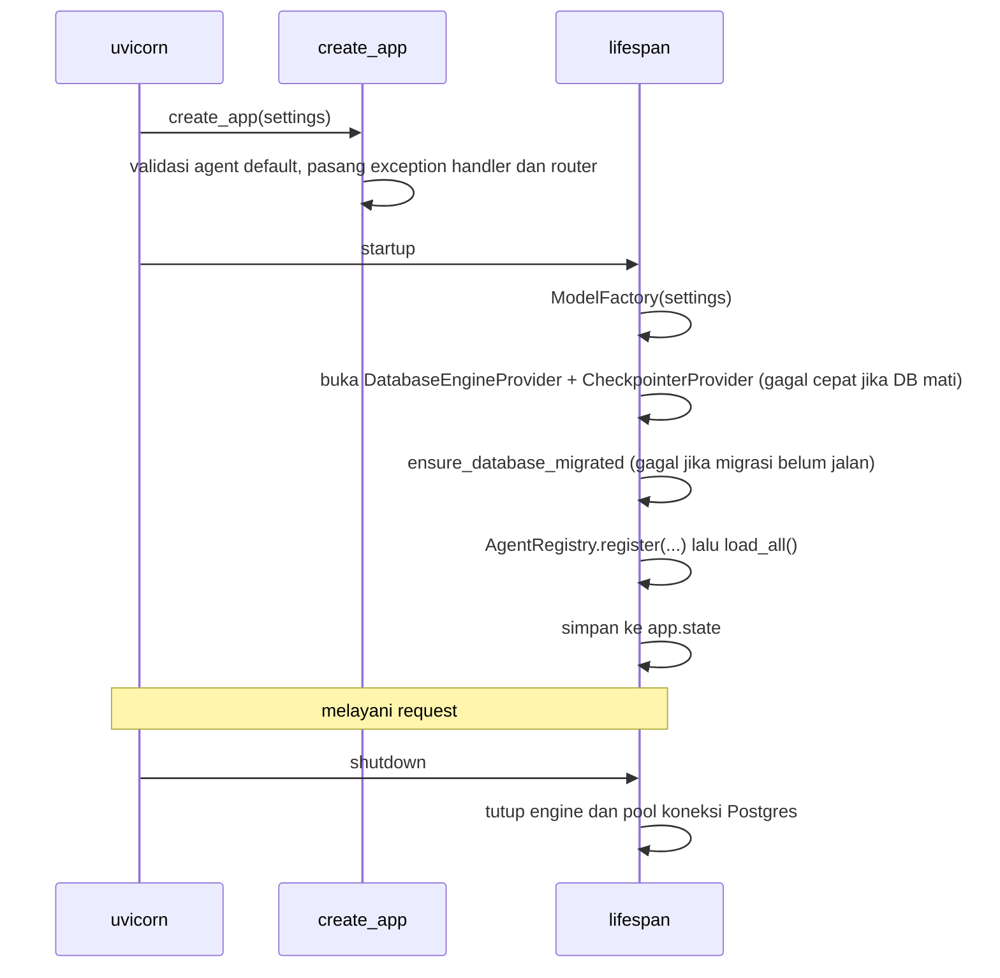
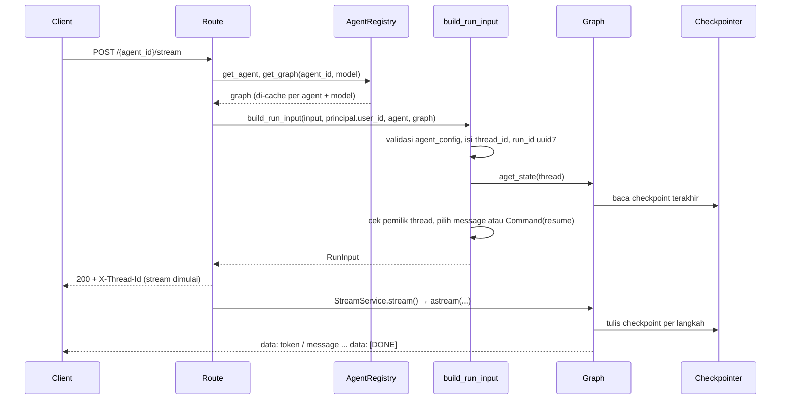

# Arsitektur

Dokumen ini menjelaskan bagaimana service bekerja dari startup sampai satu request selesai, dan
bagaimana menambah agent baru. Aturan menulis kode ada di [AGENTS.md](../AGENTS.md). Requirement dan
kontrak API ada di [PRD.md](../PRD.md).

## Gambaran Besar

Service ini membungkus graph LangGraph dengan API FastAPI. Satu proses berisi:

- **Registry agent.** Setiap agent dapat membangun graph untuk model mana pun yang diizinkan.
- **Satu database Postgres.** Database ini menyimpan checkpoint percakapan dan judul custom thread.
- **Endpoint HTTP.** Ada endpoint untuk menjalankan agent (`/invoke`, `/stream`), membaca riwayat
  (`/history`), dan mengelola thread (`/threads`).

Client dan UI (M2) berkomunikasi dengan service hanya lewat HTTP, dengan schema dari
`agent_service.schema`.

Dokumen ini menjelaskan arsitektur yang **sudah dibangun** (`v0.3.0`). Arah Fase 2 (Postgres,
harness, Project, frontend React, sandbox) ada di [ADR](adr/README.md) dan
[ROADMAP](ROADMAP.md). Bagian dokumen ini diperbarui oleh fitur yang mengubahnya.

## Layer

```text
src/agent_service/
├── core/      Settings, konstanta, configure_logging
├── llm/       ModelFactory, FakeModel
├── agents/    BaseAgent, AgentRegistry, catalog, ChatbotAgent, ToolCallingAgent, InterruptAgent,
│              SupervisorAgent, tools/
├── memory/    DatabaseEngineProvider, migrator, CheckpointerProvider, StoreProvider,
│              ThreadMetadataRepository, UserMemoryRepository
├── schema/    Model Pydantic untuk API: request, response, event SSE, nama header
├── service/   create_app, lifespan, auth, route, StreamService, ThreadRepository
├── client/    AgentClient (sync + async), StreamRun, SseParser
└── ui/        Streamlit: app, UiSettings, UrlState, ChatSession, SidebarView, ChatView, MessageRenderer
```

Panah berarti "boleh import". Import ke arah sebaliknya dilarang.

```text
ui ──► client ──► schema
service ──► agents ──► llm ──► core
service ──► memory ──► core
service ──► schema
```

- **`schema/` hanya bergantung pada pydantic dan stdlib.** Aturan ini dicek otomatis oleh
  `tests/schema/test_layering.py`. Karena itu konversi objek LangChain ke `ChatMessage` ada di
  `service/converters.py`, bukan di `schema/`.
- **`agents/` tidak mengenal schema API.** `AgentRegistry.list_agents()` mengembalikan `BaseAgent`,
  dan service yang mengubahnya menjadi `AgentInfo`.

## Siklus Hidup



- **Tidak ada side effect saat import.** `create_app()` tanpa argumen membaca `Settings()` saat
  dipanggil. Entrypoint `python -m agent_service.run_service` memanggilnya setelah
  `configure_logging`.
- **`load_all()`** menjalankan `agent.load()` dan meng-compile graph untuk model default. Agent
  yang gagal di tahap ini dicatat di log dan ditandai *unavailable* (503), sementara agent lain
  tetap berjalan.
- **`app.state`** berisi `settings`, `default_agent_id`, `model_factory`, `registry`, dan
  `thread_repository`. Route mengaksesnya lewat dependency bertipe di `service/dependencies.py`
  (`RegistryDep`, `ThreadRepositoryDep`, dan lainnya), bukan lewat `request.app.state` langsung.

## Alur Request

Setiap route agent punya dua varian: `/{agent_id}/...` dan `/...` (memakai `DEFAULT_AGENT_ID` =
`chatbot`). Keduanya memanggil helper yang sama. Semua route kecuali `/health` dan `/auth/login`
melewati dependency `current_principal` (lihat [Auth](#auth)), dan `user_id` selalu berasal dari
token.

### `/invoke` dan `/stream`



Hal penting dari alur ini:

1. **Validasi selesai sebelum response dimulai.** Agent atau model yang tidak dikenal,
   `agent_config` yang salah, dan thread milik user lain dijawab dengan JSON 404/422. Hanya error
   yang terjadi saat graph berjalan yang menjadi frame `error`, dan stream tetap diakhiri
   `[DONE]`.
2. **Graph per model.** `AgentRegistry.get_graph(agent_id, model)` meminta model ke
   `ModelFactory`, lalu memanggil `agent.build(model, checkpointer)` sekali per pasangan. Model
   pilihan request benar-benar dipakai (FR-4).
3. **Config agent sampai ke node.** `agent_config` yang lolos `config_schema` digabung ke
   `RunnableConfig["configurable"]`.
4. **`/invoke`** memanggil `graph.ainvoke` dan mengembalikan message terakhir, atau pertanyaan
   interrupt, sebagai `ChatMessage` dengan `run_id`.
5. **`/stream`** memakai `StreamService` dengan tiga stream mode:
   - `messages`: menghasilkan frame `reasoning` (jika model mengirim pemikiran) lalu `token`,
     kecuali node bertag `skip_stream`.
   - `updates`: menghasilkan frame `message` untuk jawaban AI, tool call, hasil tool, dan
     interrupt.
   - `custom`: menghasilkan frame `message` dari `get_stream_writer()`.

### Kepemilikan Thread

Thread tidak punya tabel sendiri. Setiap run menyimpan `user_id` dan `agent_id` di
`RunnableConfig["metadata"]` (`thread_access.run_metadata`), dan LangGraph menyalinnya ke
metadata setiap checkpoint. Dari situ:

- **`/invoke` dan `/stream`** boleh melanjutkan thread yang sudah ada hanya jika metadatanya
  cocok. Thread yang belum ada boleh dibuat dengan ID apa pun.
- **`/history`, `PATCH`, dan `DELETE`** mewajibkan thread sudah ada dan cocok.
- **Jika tidak cocok, jawabannya selalu 404, bukan 403,** supaya keberadaan thread tidak bocor.
- **`GET /threads`** (`ThreadRepository.list_threads`) membaca checkpoint pertama setiap thread
  (`step == -1`) dengan filter metadata, mengecek ulang pemiliknya, lalu mengurutkan thread
  berdasarkan checkpoint terakhir.

### Error

| Exception | Status | Asal |
|---|---|---|
| `AgentNotFoundError` | 404 | `AgentRegistry.get_agent` |
| `ThreadNotFoundError` | 404 | `ensure_thread_owner` |
| `UnknownModelError` | 422 | `ModelFactory.resolve_name` |
| `RequestValidationError` | 422 (list per field) | Body/query FastAPI, `parse_agent_config` |
| `AgentUnavailableError` | 503 | Agent yang gagal `load()`/`build()` saat startup |
| `ModelNotConfiguredError` | 503 | Model asli tanpa `LLM_BASE_URL`/`LLM_API_KEY` |
| Exception lain | 500, `"Internal server error"` | Dicatat dengan `logger.exception` |

Pemetaan ini ada di `service/errors.py` (`DOMAIN_ERROR_STATUS`), dan subclass ikut terpetakan
lewat MRO. Selain handler 500, satu-satunya `except Exception` yang diizinkan ada di
`AgentRegistry._load` (batas plugin agent) dan `StreamService.stream` (batas SSE).

## Auth

Auth per user dengan JWT (FR-33), tanpa mode anonim: `JWT_SECRET` wajib diisi.

- **Akun** ada di tabel `users` (`UserRepository`), dan dibuat hanya lewat CLI
  `python -m agent_service.manage create-user <username> [--role service]`. Username dinormalisasi
  ke huruf kecil (`[a-z0-9._-]`, 3–32 karakter). Password di-hash dengan argon2id.
- **`POST /auth/login`** memanggil `Authenticator.login`. Username yang tidak ada tetap diverifikasi
  terhadap hash tiruan, supaya waktu respons tidak membocorkan username mana yang terdaftar. Kedua
  kegagalan menjawab 401 dengan pesan yang sama.
- **Token** JWT HS256 berisi `sub` (= `user_id`), `role` (`user` atau `service`), `iat`, dan `exp`
  (`JWT_TTL_SECONDS`, default 12 jam). Tidak ada refresh token. Verifikasinya stateless: tanpa query
  database per request, jadi akun yang dihapus tetap bisa memakai tokennya sampai kedaluwarsa.
- **`current_principal`** (`service/dependencies.py`) dipasang per router di `create_app`, dan diminta
  lagi oleh route yang butuh `user_id` (`PrincipalDep`). FastAPI meng-cache dependency per request,
  jadi token diverifikasi sekali. Header yang tidak ada, token rusak, salah tanda tangan,
  kedaluwarsa, atau klaim tidak dikenal menjawab 401 dengan `WWW-Authenticate: Bearer`.
- **Role `service`** disiapkan untuk worker (F41) dan eval (F31). Saat ini aksesnya sama dengan
  `user`.
- **CORS** (FR-34): `CORSMiddleware` hanya mengizinkan origin di `CORS_ORIGINS`, method yang dipakai
  API, header `Authorization`/`Content-Type`, dan mengekspos `X-Thread-Id`. Token dikirim lewat
  header, bukan cookie, jadi `allow_credentials` tidak dipakai.

## System Prompt

`ContextBuilder` (`harness/context.py`, FR-37, [ADR 0002](adr/0002-own-harness.md)) merakit system
prompt di **setiap** panggilan model, dengan urutan bagian yang tetap:

| Urutan | Bagian | Sumber | Batas |
|---|---|---|---|
| 1 | Instruksi agent (tanpa judul) | Konstruktor `ContextBuilder(instructions)` | 8000 |
| 2 | `## Project instructions` | `configurable["project_instructions"]` (F26) | 8000 |
| 3 | `## Skills` | `SkillToolkit` (F28): nama + deskripsi skill aktif | 4000 |
| 4 | `## Memory` | `MemoryToolkit` (F30): 20 memory terbaru milik user | 4000 |
| 5 | `## Summary of earlier conversation` | `ContextPolicy` (F29): ringkasan dari state thread | 4000 |
| 6 | `## Environment` | `clock` yang di-inject: tanggal dan timezone | 300 |

- **Batas per bagian.** Bagian yang melebihi batas dipotong dan diberi penanda `[truncated]`, jadi
  satu sumber yang panjang tidak bisa mendorong bagian lain keluar. Bagian kosong dilewati.
- **Komposisi, bukan base class.** `ChatbotAgent`, `ToolCallingAgent`, dan `SupervisorAgent`
  menerima `ContextBuilder` lewat konstruktor dan memanggil `system_message(config)` di node, yang
  menerima `config` dari LangGraph. Agent tidak lagi memformat `{current_date}` sendiri.
- **Bagian lingkungan selalu ada** (keputusan user, F27), termasuk untuk `chatbot` yang di v1 tidak
  punya system prompt. Prompt v1 hanya bertambah bagian ini; isi dan urutan instruksi agent tetap.
- **Expert supervisor tidak menerima instruksi project** (`use_project_instructions=False`).
  Expert tidak melihat percakapan dan hanya mengerjakan satu tugas teknis. Supervisor, yang
  menyusun jawaban akhir, yang menerapkan instruksi project.
- `interrupt-agent` masih memakai prompt tetap untuk ekstraksi dan jawaban, sehingga instruksi
  project belum berlaku untuknya.

## Context Policy

`ContextPolicy` (`harness/context_policy.py`, FR-39) menjaga riwayat yang dikirim ke model tetap
di bawah `CONTEXT_MAX_TOKENS` (default 16.000). Node model `ToolCallingAgent` dan `SupervisorAgent`
memanggil `prepare()` sebelum setiap panggilan model.

```text
messages (state, lengkap) ──► sesudah summarized_through ──► muat di anggaran? ── ya ──► kirim
                                                                   │ tidak
                                                                   ▼
                              unit lama ──► model (tag skip_stream) ──► summary baru (state)
                              unit terbaru (≤ 50% anggaran) ──► kirim, ringkasan di system prompt
```

- **Unit.** `AIMessage` dengan `tool_calls` selalu satu unit dengan `ToolMessage`-nya, jadi
  pemangkasan tidak pernah memisahkan tool call dari hasilnya. Unit terakhir selalu dikirim.
- **Bertahap** (keputusan user F29). Saat anggaran terlampaui, unit lama diringkas sekaligus sampai
  riwayat langsung tinggal `keep_ratio` (50%) anggaran. Giliran berikutnya tidak meringkas lagi
  sampai anggaran penuh lagi, jadi panggilan model tambahan jarang terjadi.
- **State thread.** `summary` dan `summarized_through` (ID message terakhir yang sudah diringkas)
  disimpan di state graph. `messages` tidak pernah diubah, jadi `/history` tetap lengkap. Thread
  lama tanpa field ini dianggap belum punya ringkasan.
- **Batas.** Anggaran mencakup riwayat dan ringkasan. Ringkasan dibatasi `SUMMARY_MAX_CHARS` atau
  seperempat anggaran. System prompt lain di luar anggaran karena setiap bagiannya sudah dibatasi.
  Unit tunggal yang lebih besar dari anggaran (misalnya hasil tool yang sangat panjang) dipotong di
  salinan yang dikirim, dengan penanda `[truncated]`.
- **Peringkasan.** Model yang sama tanpa tool, bertag `skip_stream` (token dan reasoning-nya tidak
  dialirkan ke chat). Backlog yang lebih besar dari anggaran diringkas per batch. Respons kosong
  mempertahankan ringkasan lama. Kegagalan panggilan model tidak ditangkap, jadi run gagal seperti
  kegagalan model biasa.
- Token dihitung dengan `count_tokens_approximately` (±4 karakter per token). Pada `qwen3.5:9b`
  perkiraan ini 1–8% di atas hitungan Ollama, jadi meleset ke sisi aman.
- Expert supervisor memakai `ContextPolicy()` default (setiap delegasi mulai dari state kosong,
  jadi praktis tidak pernah meringkas). `interrupt-agent` tidak memakainya karena percakapannya
  pendek.

## Long-Term Memory

Memory user (FR-40) disimpan di `AsyncPostgresStore` dengan namespace
`("users", user_id, "memories")`.

```text
model ──► save_memory(memory) ──► interrupt("Save this...?") ──► balasan user (pesan berikutnya)
                                                                   │ "yes"/"ya"/...  │ lainnya
                                                                   ▼                 ▼
                                               UserMemoryRepository.save   ToolMessage "did not approve"
setiap giliran: UserMemoryRepository.list_memories(user, 20) ──► ## Memory di system prompt
```

- **Store per graph.** Pool store baru dibuka di lifespan, sedangkan agent dibuat di `create_app`.
  Karena itu `BaseAgent.build(model, checkpointer, store=None)` menerima store, dan
  `AgentRegistry(model_factory, checkpointer, store)` meneruskannya. `ToolCallingAgent` dengan
  `use_memory=True` membuat `MemoryToolkit(store)` per graph. Tanpa store, graph sama seperti
  sebelum F30.
- **Agent.** `chatbot` dan `research-assistant` (keputusan user F30). Supervisor dan expert-nya
  tidak, karena expert dijalankan tanpa checkpoint sehingga interrupt persetujuan tidak bisa
  dilanjutkan. Tool memory selalu di-bind di agent ber-memory.
- **Persetujuan.** `save_memory` memanggil `interrupt()` dari dalam `ToolNode`. Run berhenti, dan
  pertanyaannya tampil sebagai message AI. Pesan user berikutnya menjadi nilai resume. Jawaban
  dianggap setuju jika diawali kata setuju (`yes`, `ya`, `ok`, `simpan`, ...) dan hanya berisi kata
  setuju/pengisi, jadi "ya tapi ganti jadi X" adalah penolakan yang diteruskan ke model.
- **Idempoten.** Saat run dilanjutkan, `ToolNode` menjalankan ulang semua tool call di giliran
  itu, termasuk `save_memory` yang sudah disetujui. ID memory adalah uuid5 dari teks (tanpa beda
  huruf besar-kecil), jadi penyimpanan ulang menimpa memory yang sama. Dua `save_memory` dalam satu
  giliran ditanyakan bergantian.
- **Isolasi (NFR-9).** User diambil dari `configurable["user_id"]` (diisi service dari token), dan
  prefix namespace store dicocokkan per elemen. `GET`/`DELETE /memories` hanya membaca namespace
  pemilik token. ID memory user lain menjawab 404.
- **Pencarian** tanpa embedding: `search_memory` mengurutkan memory berdasarkan jumlah kata kunci
  (≥ 3 huruf) yang menjadi awal kata di memory, lalu yang terbaru. Karena pencarian berjalan di
  Python, jumlah memory dibatasi 200 per user sampai index embedding tersedia (F43).

## Trace dan Eval

**Trace** (FR-41, keputusan user F31: tabel Postgres, dibaca lewat API).

```text
route /invoke|/stream ──► RunTraceCollector (callback LangChain di config run)
                            on_chat_model_start/on_llm_end   → span model (+ usage_metadata)
                            on_tool_start/on_tool_end/error  → span tool
akhir run ──► save(status) ──► RunTraceRepository.add_spans (satu INSERT) ──► run_traces
GET /runs/{run_id}/trace ──► span milik pemilik token, span `run` lebih dulu
```

- **Span.** `run` (span_id = run_id, durasi seluruh run, total token, status akhir), `model`, dan
  `tool`. Hierarki tidak disimpan; span diurutkan berdasarkan waktu mulai. Panggilan model
  peringkasan (F29) dan expert supervisor ikut tercatat karena callback diwariskan lewat config.
- **Status.** `ok`, `error` (nama exception + pesan, ≤ 500 karakter), atau `interrupted` (run
  berhenti untuk bertanya; `GraphInterrupt` di dalam tool `save_memory` juga dicatat sebagai
  `interrupted`, bukan error).
- **Tanpa konten.** Prompt, jawaban, dan argumen/hasil tool tidak disimpan. Isi percakapan sudah
  ada di checkpoint, jadi trace tidak menggandakan data user.
- **Tulis sekali.** Span dikumpulkan di memori lalu ditulis di akhir run. `SQLAlchemyError` saat
  menulis hanya dicatat di log, jadi database trace yang gagal tidak mengubah jawaban. Stream yang
  diputus client di tengah jalan bisa kehilangan trace-nya.
- **Token** dari `usage_metadata`. `ModelFactory` menyalakan `stream_usage=True`, supaya provider
  OpenAI-compatible mengirim usage di chunk terakhir stream. FakeModel tidak mengirim usage.

**Eval** (`src/agent_service/evals/`, dataset di `evals/`). Package ini hanya meng-import `client/`
dan `schema/` (`tests/evals/test_layering.py`), dan punya extra `evals` sendiri (pydantic-settings,
pyyaml).

- `EvalRunner` menjalankan setiap kasus di thread baru lewat `AgentClient` (service account):
  `ainvoke` → `aget_history` (tool call, skill yang dimuat lewat argumen `load_skill`) →
  `aget_run_trace` (latensi di service dan token). Error HTTP menggagalkan kasus itu saja.
- Skor deterministik di `scoring.py`. LLM judge ditunda (keputusan user F31).
- `run_evals` menulis `eval-reports/eval-<waktu>.json` dan `.md`, exit code 0/1/2 (lolos, ada kasus
  gagal, konfigurasi atau dataset salah).
- CI: `tests/evals/test_datasets.py` memvalidasi semua dataset dan menjalankan `evals/smoke.yaml`
  dengan FakeModel in-process. Test e2e menjalankan CLI `run_evals` terhadap stack Compose.

## Skill

Skill built-in (FR-38, [ADR 0005](adr/0005-skill-format-and-sources.md)) memakai format Agent
Skills: `skills/builtin/<name>/SKILL.md` (frontmatter YAML + Markdown) dan file pendukung di
subfolder.

- **Pemuatan.** `SkillRegistry([FilesystemSkillSource(BUILTIN_SKILLS_DIR)])` dibuat di `create_app`
  (agent butuh referensinya), lalu `load()` dijalankan di awal lifespan. `parse_skill_markdown`
  memvalidasi `name` (sama dengan nama folder, huruf kecil, ≤ 64), `description` (≤ 1024),
  `compatibility`, dan `metadata`. Skill tidak valid dicatat lalu dilewati, tanpa menggagalkan
  startup. Sumber lain (B1) cukup memenuhi protokol `SkillSource`.
- **ID** berbentuk `<scope>/<name>` (`builtin/meeting-notes`), dipakai di `Project.skill_ids`.
  Model memakai nama pendek, karena nama unik di antara skill aktif satu project.
- **Progressive disclosure.** `SkillToolkit` mengisi slot `skills` di `ContextBuilder` dengan nama
  dan deskripsi skill aktif (dari `configurable["project_skill_ids"]`), dan menyediakan tool
  `load_skill(name, path?)`. Tool membaca config yang disuntikkan LangChain (tidak terlihat di
  schema tool), menolak skill yang tidak aktif dengan `ToolException`, hanya membaca file yang
  tercatat sebagai resource skill, dan memotong isi di 20.000 karakter.
- **Bind per giliran.** `ToolCallingAgent` (termasuk `ChatbotAgent`, yang kini dibangun di atasnya
  tanpa tool bawaan) menyiapkan dua model: tanpa tool skill, dan dengan `load_skill`. Model kedua
  hanya dipakai pada giliran yang project-nya punya skill aktif. Tanpa tool sama sekali, graph
  chatbot tetap `agent → END`.
- **Validasi project.** `ProjectService` menolak `skill_ids` yang tidak dikenal registry (422), dan
  saat seeding melewati skill built-in yang tidak termuat.
- Supervisor belum memakai skill.

## Project

Project adalah agent deklaratif (FR-36, [ADR 0004](adr/0004-project-as-declarative-agent.md)):
satu agent kode plus konfigurasi.

- **Penyimpanan.** Tabel `projects` (`ProjectRepository`), dengan `skill_ids` dan `settings` sebagai
  JSONB. `scope = builtin` berarti `owner_id` kosong (dijaga check constraint).
- **Akses** ada di `ProjectService` (`service/projects.py`). Project milik user lain → 404,
  mengubah atau menghapus built-in → 403, dan agent yang tidak tersedia → 422. Menghapus project
  menghapus semua thread di dalamnya lebih dulu (`ThreadRepository.delete_project_threads`).
- **`base_agent_id` tidak bisa diubah**, karena thread menyimpan `agent_id` di metadata checkpoint.
  Mengganti agent akan membuat thread lama tidak bisa dibuka, atau dijalankan dengan graph yang
  tidak cocok dengan state-nya.
- **Built-in** didefinisikan sebagai data (`BUILTIN_PROJECTS` di `agents/catalog.py`) dan di-upsert
  di lifespan, hanya jika agent dasarnya terdaftar. Urutannya di daftar berdasarkan nama.
- **Run di project.** Route `/projects/{project_id}/...` membaca project di awal setiap run, lalu
  membentuk `RunTarget`: agent dasar, model (request → project → default), `max_tokens` project,
  dan `ProjectRunContext`. `AgentRegistry.get_graph(agent, model, max_tokens)` meng-cache graph per
  ketiganya. Instruksi dan skill project diteruskan lewat `configurable` (`project_id`,
  `project_instructions`, `project_skill_ids`, kuncinya di `core/constants.py`) untuk F27/F28.
- **Isolasi thread.** `run_metadata` menulis `project_id` untuk thread project, dan
  `is_thread_owner` membandingkannya. Thread project tidak bisa dibuka lewat route agent atau
  project lain, dan sebaliknya. Thread tanpa key `project_id` (termasuk thread sebelum F26) adalah
  thread tanpa project. Listing route agent menyaring thread project di Python, karena key yang
  tidak ada tidak bisa difilter dengan containment JSONB.

## Kontrak API

`service/contracts.py` membuat dua file di `contracts/` (FR-35):

- **`openapi.json`** dari `create_app(...).openapi()` dengan `Settings` tiruan (tanpa `.env`, tanpa
  lifespan, jadi tanpa database atau LLM) dan hanya `ChatbotAgent`. Route agent memakai path
  generik `/{agent_id}/...`, jadi daftar agent tidak memengaruhi kontrak. `info.version` diambil
  dari versi package. Header `X-Thread-Id` didokumentasikan di respons `/invoke` dan `/stream`
  (`RUN_RESPONSE_HEADERS`), dan route terlindungi mendeklarasikan skema `HTTPBearer`.
- **`stream-event.schema.json`** dari `STREAM_EVENT_ADAPTER.json_schema()`, ditambah `$schema`
  (draft 2020-12), judul `StreamEvent`, dan penjelasan penanda akhir `[DONE]` yang bukan JSON.

Serialisasinya deterministik: key terurut, indentasi 2, UTF-8, LF, dan newline di akhir.
`python -m agent_service.export_contracts` menulis file. Opsi `--check` hanya membandingkan dan
keluar dengan kode 1 jika ada file yang usang atau hilang (dipakai CI dan hook pre-commit
`api-contracts`).

Docstring model dan route menjadi deskripsi di OpenAPI, jadi doctest-nya ditaruh di docstring
modul. Test `test_contracts_carry_no_internal_docstrings` menjaga aturan ini.

## Frontend

React + TypeScript di `frontend/` (FR-42, [ADR 0003](adr/0003-frontend-stack.md)).

```text
browser ──► web :3000 (nginx) ── /            → dist/ (SPA, fallback index.html)
                               └─ /api/*      → agent-service:8080/* (proxy, SSE tanpa buffering)
dev:  vite :5173 ── /api/* → AGENT_URL (default 127.0.0.1:8080)
```

- **Same-origin** (keputusan user F32): frontend selalu memanggil `<origin>/api`. Tanpa CORS, dan
  URL service tidak di-bake ke build. `API_UPSTREAM` image `web` diisi lewat template envsubst
  nginx.
- **Auth.** `SessionStore` menyimpan token di `sessionStorage` beserta `expiresAt` absolut. Sesi
  yang kedaluwarsa dibuang saat dibaca. `AuthProvider` memasang client `openapi-fetch` yang
  membaca token dari store di setiap request, dan logout saat respons 401 untuk request yang
  membawa token. `RequireAuth` mengarahkan ke `/login`.
- **Route** (mode data React Router): `/login`, lalu layout terproteksi `AppShell` (sidebar
  shadcn: chat baru, Recents, user + logout) dengan `ChatPage` di `/` (chat baru) dan
  `/chat/:threadId` (keputusan user F33). Kedua route memakai komponen yang sama, jadi state tetap
  utuh saat URL chat baru diganti ke thread yang baru dibuat.
- **Tipe** dari `contracts/openapi.json` (`openapi-typescript`) dan
  `contracts/stream-event.schema.json` (`scripts/stream-events.mjs`, json-schema-to-typescript),
  dicek drift-nya oleh hook `frontend-check` dan CI.

### Chat (F33)

```text
ChatPage ── useChatRuntime ── useExternalStoreRuntime (assistant-ui) ──► Thread
                │
                └─ ChatController (state di luar React, useSyncExternalStore)
                      ├─ ChatService.startRun  → POST /stream (parseAs stream) → readStreamEvents
                      ├─ ChatService.loadHistory → POST /history
                      └─ conversation.ts: applyStreamEvent → toThreadMessages
```

- **Spesifikasi acuan** adalah `MessageRenderer` Streamlit. Semua message setelah satu pesan user
  menjadi satu message asisten: reasoning dan token live, lalu diganti message utuh. Hasil tool
  mengisi part tool call yang `tool_call_id`-nya sama. Part dari message ber-`agent` membawa
  `parentId` = nama expert, dan `thread.tsx` mengelompokkannya per expert (FR-23).
- **Status message** memakai status assistant-ui: `incomplete/length` untuk `truncated` (FR-30),
  `incomplete/error` untuk frame `error`, dan `incomplete/cancelled` saat user menekan Stop. Teks
  yang sudah di-stream tetap tampil saat run dihentikan.
- **Pindah thread** menaikkan `generation` controller dan membatalkan run aktif (`AbortController`),
  sehingga event atau riwayat yang terlambat dari thread sebelumnya diabaikan.
- **Agent** selalu `default_agent` lewat `POST /stream` untuk chat umum. Model dipilih di composer
  dari `/info` (keputusan user F33). Agent lain dipakai lewat Project (F34).
- **Template.** `src/components/assistant-ui/elements/` disalin dari registry assistant-ui tanpa
  diubah; ESLint mematikan aturan yang dilanggar upstream hanya di folder itu. `thread.tsx`
  dipangkas dan disesuaikan (keputusan user: template boleh diedit). Registry saat ini meminta
  `@assistant-ui/react` ^0.15.36 (belum lolos jeda 14 hari); template lolos type check dengan
  0.15.32 yang di-pin.
- **Test** memakai rekaman SSE dan riwayat asli (`src/features/chat/__fixtures__/`, Ollama
  `qwen3.5:9b`). Riwayat thread yang dibuka ulang harus menghasilkan message yang sama persis
  dengan hasil stream-nya.
- **Vendor.** `src/components/ui/` dan `src/hooks/use-mobile.ts` hasil CLI shadcn tidak diedit.
  ESLint mematikan tiga aturan untuk file vendor (Fast Refresh, `react-hooks/purity`,
  `react-hooks/set-state-in-effect`); kode aplikasi tetap memakai semuanya.
- **Tooling.** Node 24, pnpm 12 via corepack, `minimumReleaseAge` 14 hari (setara
  `exclude-newer` uv). TypeScript dipin `~5.9`, karena typescript-eslint dan openapi-typescript
  belum mendukung TypeScript 7.

### Projects dan threads (F34)

```text
AppShell ── RecentsList ── useThreads(null) ── ThreadsService → GET/PATCH/DELETE /threads
/projects ─────────────── ProjectsPage ── useProjects → GET /projects
/projects/new, /:id/edit ─ ProjectForm (react-hook-form + zod) → POST/PATCH /projects, GET /skills
/projects/:id[/chat/:t] ── ProjectChatPage ── ChatPage key=projectId, projectId
                              ├─ ChatService(api, projectId) → /projects/{id}/stream, /history
                              └─ ProjectOverview (welcome) ── useThreads(projectId)
```

- **Scope thread.** Chat umum dan chat project memakai komponen yang sama dengan `projectId`
  `null` atau id project. URL dan query key (`["threads", projectId ?? "general"]`) ada di
  `features/threads/thread-paths.ts`. Recents hanya berisi chat umum, karena `GET /threads` hanya
  mengembalikan thread tanpa project (keputusan user F34).
- **Refresh daftar thread.** `ChatController` memanggil `onThreadCreated` dan `onRunFinished`;
  `ChatPage` meng-invalidate query thread scope-nya, sehingga judul dan urutan di sidebar atau
  halaman project ikut berubah. Rename dan hapus meng-invalidate lewat mutation.
- **Halaman project** adalah `ChatPage` dengan `welcome` = ringkasan project, jadi composer ada di
  halaman project (keputusan user F34). `key={projectId}` membuat controller baru saat pindah
  project; URL chat baru → thread tetap memakai komponen yang sama.
- **Read-only.** Project built-in (`read_only`) tidak punya menu edit/hapus, dan halaman edit-nya
  hanya menampilkan pemberitahuan. Service tetap menjadi penjaga (403).
- **Form** memvalidasi batas yang sama dengan `schema/projects.py` (nama 1–80, deskripsi ≤ 500,
  instruksi ≤ 8000, maksimal 20 skill, batas token ≥ 1). Error service (misalnya model tidak
  dikenal) tampil di bawah form.

## Persistence

Satu database Postgres di `DATABASE_URL` ([ADR 0001](adr/0001-postgres-only.md)):

| Tabel | Pemilik | Isi |
|---|---|---|
| `checkpoints`, `checkpoint_blobs`, `checkpoint_writes`, `checkpoint_migrations` | `AsyncPostgresSaver` (via `CheckpointerProvider`) | State graph per langkah, termasuk metadata `user_id`/`agent_id` |
| `thread_metadata` | `ThreadMetadataRepository` (SQLAlchemy Core) | Judul custom hasil rename |
| `users` | `UserRepository` (SQLAlchemy Core) | Akun login: username, hash argon2, role |
| `projects` | `ProjectRepository` (SQLAlchemy Core) | Project built-in dan milik user |
| `store`, `store_migrations` | `AsyncPostgresStore` (via `StoreProvider`) | Long-term memory user (F30) |
| `run_traces` | `RunTraceRepository` (SQLAlchemy Core) | Trace run: satu baris per span run/model/tool (F31) |
| `workspace_files` | `PostgresWorkspace` (SQLAlchemy Core) | File workspace per thread: path, isi (bytes), ukuran (F36) |
| `artifacts` | `ArtifactRepository` (SQLAlchemy Core) | Metadata artifact: pemilik, thread, nama, tipe, ukuran (F35). Isi file di `ArtifactStore` |
| `alembic_version` | Alembic | Revisi skema tabel aplikasi |

- **Satu driver.** Checkpointer dan SQLAlchemy sama-sama memakai psycopg 3. `DATABASE_URL` ditulis
  `postgresql://...`, dan `sqlalchemy_url()` menambahkan `+psycopg` untuk SQLAlchemy.
- **Tiga pool per proses.** `CheckpointerProvider` dan `StoreProvider` masing-masing membuka
  `AsyncConnectionPool` psycopg lewat `memory/pool.py` (autocommit, tanpa prepared statement, baris
  dict, sesuai syarat saver/store LangGraph). `DatabaseEngineProvider` membuka engine SQLAlchemy.
  Semuanya mengecek koneksi saat startup dengan `connect_timeout` 5 detik, karena default psycopg
  adalah 130 detik.
- **Migrasi terpisah dari service.** `python -m agent_service.run_migrate` (service compose
  `migrate`) menjalankan `AsyncPostgresSaver.setup()`, `AsyncPostgresStore.setup()`, lalu
  `alembic upgrade head`. Revisi `0004` tidak mengubah skema; ia memaksa database lama dimigrasi
  ulang supaya tabel store pasti ada. Lifespan hanya memanggil `ensure_database_migrated`, yang membandingkan `alembic_version` dengan revisi terbaru.
  Tabel aplikasi baru ditambahkan di `memory/tables.py` beserta revisi di `memory/migrations/`.
- **Event loop.** psycopg async tidak bisa memakai `ProactorEventLoop`, loop default di Windows.
  `run_service` memberi uvicorn `loop="asyncio:SelectorEventLoop"`, `run_migrate` memakai
  `asyncio.run(..., loop_factory=asyncio.SelectorEventLoop)`, dan test memakai hook
  `pytest_asyncio_loop_factories`.

Penghapusan thread memanggil `adelete_thread`, menghapus judulnya, lalu menjalankan setiap
`ThreadDataCleanup` (artifact thread F35, workspace thread F36).

### Artifact (F35)

```text
POST /artifacts ── ArtifactService.upload ── LocalArtifactStore.write (.part → rename)
                                         └─ ArtifactRepository.add (metadata, thread_id kosong)
POST /invoke|/stream {artifact_ids} ── build_attached_run_input
    ├─ ArtifactService.resolve_attachments  (milik user? 404; thread lain? 409)
    ├─ build_run_input → HumanMessage(additional_kwargs["artifacts"] = [ArtifactRef])
    └─ ArtifactService.link(thread_id)      (setelah kepemilikan thread lolos)
GET /history ── langchain_to_chat_message → ChatMessage.artifacts
DELETE thread/project ── ThreadRepository._remove → ArtifactService.delete_thread_data
```

- **Isi dan metadata terpisah.** `files/artifacts.py` berisi protocol `ArtifactStore` dan
  `LocalArtifactStore` (folder `ARTIFACT_DIR`, volume `artifacts` di compose). Metadata ada di
  tabel `artifacts`. Store S3-compatible (backlog B7) cukup mengimplementasikan protocol.
- **Batas ukuran** ditegakkan saat isi upload disalin ke store; file `.part` dihapus jika melebihi
  `ARTIFACT_MAX_BYTES` (413). Proxy nginx image `web` punya batas sendiri (`API_MAX_BODY_SIZE`).
- **Keamanan unduhan.** Selalu `Content-Disposition: attachment` (nama ASCII + `filename*` UTF-8),
  `X-Content-Type-Options: nosniff`, dan `Content-Security-Policy: sandbox`, jadi HTML/SVG tidak
  pernah dirender di origin aplikasi. Nama file disanitasi (tanpa path dan karakter kontrol).
- **Satu artifact, satu thread.** Artifact ditautkan ke thread saat pertama kali dikirim, supaya
  penghapusan thread tahu file mana yang ikut dihapus. Lampiran tidak bisa menjadi jawaban
  interrupt (422), karena `Command(resume=...)` tidak membawa message human.
- **Isolasi.** Semua pembacaan disaring `owner_id`; artifact user lain dan ID yang bukan UUID
  dijawab 404 dengan pesan yang sama.

### Workspace dan tool file (F36)

```text
service: build_attached_run_input
    ├─ lampiran → ArtifactService.copy_to_workspace → uploads/<nama>
    │            HumanMessage.additional_kwargs["workspace_files"]
    └─ RunInput.context = HarnessContext(workspace, artifacts=ArtifactService)
graph.ainvoke / astream (..., context=run.context)
ToolCallingAgent(files=WorkspaceToolkit)
    ├─ call_model: with_attachment_notes(messages) → model melihat path lampiran
    └─ ToolNode(awrap_tool_call=ToolOutputOffloader)
          read_file · write_file · edit_file · list_files · grep · share_file
          ToolRuntime[HarnessContext] → workspace + thread_id/user_id dari config
          output > TOOL_OUTPUT_MAX_TOKENS → tool-outputs/<id>.txt + cuplikan
```

- **Runtime context, bukan konstruktor.** Agent dibuat di `create_app` sebelum database ada, jadi
  workspace dan penerbit artifact datang per run lewat `context=` (`harness/runtime.py`). Run tanpa
  context (sub-agent, test unit) membuat tool file menjawab "workspace not available".
- **Isolasi.** Tool tidak menerima thread dari model: `thread_id` dan `user_id` dibaca dari config
  yang ditetapkan service setelah kepemilikan thread diperiksa. Path dinormalisasi
  (`normalize_workspace_path`): path absolut, huruf drive, `..`, dan karakter kontrol ditolak.
- **Isi bytes.** File biner (lampiran PDF, gambar dari sandbox F37) disimpan apa adanya; `read_file`
  dan `grep` hanya membaca teks UTF-8. `share_file` menerbitkan file apa pun sebagai artifact yang
  tertaut ke thread, lewat `ToolMessage.additional_kwargs["artifacts"]`.
- **Offload.** `ToolOutputOffloader` memotong output tool lain yang melebihi
  `TOOL_OUTPUT_MAX_TOKENS`, menyimpan isi utuh di `tool-outputs/<tool_call_id>.txt`, dan memberi
  model seperempat batas sebagai cuplikan. `read_file`, `list_files`, dan `grep` membatasi
  outputnya sendiri (paging per baris), jadi tidak di-offload.
- **`grep` literal.** Pola dari model dicocokkan sebagai substring, bukan regex, karena `re` tidak
  punya timeout dan berjalan di event loop service.

## Agent dengan Tool

`ToolCallingAgent` (`agents/tool_calling.py`) adalah agent generik yang dikonfigurasi lewat daftar
tool dan system prompt. Graph-nya `agent → tools → agent`: node `agent` memanggil model dengan
tool yang sudah di-bind, `tools_condition` mengarahkan tool call ke `ToolNode`, lalu hasilnya kembali
ke model sampai model menjawab tanpa tool call.

- **System prompt dirakit `ContextBuilder`** setiap kali model dipanggil (lihat
  [System Prompt](#system-prompt)). System message tidak disimpan di riwayat.
- **`ToolException`** dari tool dikembalikan ke model sebagai `ToolMessage` berstatus `error`, jadi
  model bisa mencoba lagi. Exception lain tetap menggagalkan run.
- **Jika sisa langkah kurang dari `MIN_REMAINING_STEPS`**, model tidak boleh memanggil tool baru dan
  menjawab `STEP_LIMIT_MESSAGE`.
- **Tool** ditulis sebagai function `@tool` di `agents/tools/`. Docstring-nya berbahasa Inggris
  karena menjadi deskripsi tool untuk model. Tool dengan dependency (misalnya mesin pencari) dibuat
  lewat factory yang menerima dependency tersebut, supaya test bisa memakai tiruan tanpa network.

`research-assistant` (`agents/research.py`) adalah `ToolCallingAgent` dengan `web_search`
(Firecrawl Search API) dan `calculator` (numexpr).

Tool `web_search` memakai `SearchBackend` async yang di-inject. `create_app` membuatnya dari
`FIRECRAWL_API_KEY` (`build_search_backend`): `FirecrawlSearch` (satu `httpx.AsyncClient`,
`POST /v2/search`, hanya hasil web tanpa scraping) jika key ada, atau `UnconfiguredSearch` jika
kosong. Pada kasus kedua, tool menjawab "not configured" dan agent tetap berjalan. Error
pencarian (koneksi, 401/402/429, respons rusak) menjadi `SearchError` → `ToolException`, lalu
dikembalikan ke model.

## Human-in-the-loop

`InterruptAgent` (`agents/interrupt.py`) menunjukkan pola `interrupt()` yang dipakai ulang:

```text
START ─► (data sudah ada?) ─ya─► respond ─► END
             │ tidak
             ▼
          extract ─► (valid?) ─ya─► respond
             ▲           │ tidak
             └── ask ◄───┘   ask memanggil interrupt(pertanyaan)
```

- **`ask_birthdate`** memanggil `interrupt(pertanyaan)`. Service mengirim pertanyaan itu sebagai
  message AI. Giliran user berikutnya di thread yang sama dikirim sebagai `Command(resume=...)`
  (`build_run_input`), sehingga node yang sama dijalankan ulang dan `interrupt()` mengembalikan
  jawaban user. Jawaban itu dikembalikan sebagai `HumanMessage` baru, tanpa memutasi state.
- **Ulangan** terjadi lewat edge `ask → extract`, bukan rekursi.
- **Panggilan LLM internal** (ekstraksi terstruktur) diberi tag `skip_stream`, sehingga tidak muncul
  sebagai token. Hasilnya juga tidak disimpan sebagai message.
- **Data yang sudah valid** disimpan di state thread, sehingga giliran berikutnya langsung ke
  `respond`.

## Multi-agent (Supervisor)

`SupervisorAgent` (`agents/supervisor.py`) adalah graph `supervisor ⇄ delegate`:

- **`supervisor`** adalah LLM dengan satu tool delegasi `ask_<expert>(task)` per `Expert`. Node ini
  hanya melihat message tanpa penanda sub-agent, jadi urutan tool call dan hasilnya tetap valid.
- **`delegate`** menjalankan graph stateless milik expert (`ToolCallingAgent.build_stateless`) dengan
  model yang sama dari request (FR-4) dan tag run `subagent`. Setiap message expert ditandai
  `additional_kwargs["subagent"]`, dikirim bertahap lewat `get_stream_writer()`, lalu disimpan.
  Jawaban akhir expert dikembalikan ke supervisor sebagai `ToolMessage`.
- **Converter** mengubah penanda itu menjadi `ChatMessage.agent`. `StreamService` tidak mengalirkan
  token dari run bertag `subagent`, dan mengirim message expert sekali saja (dedupe per `id`).
- **UI** merender message ber-`agent` di kontainer berbingkai bernama expert, baik saat live maupun
  di riwayat.

## Menambah Agent

1. **Buat subclass `BaseAgent`** di `src/agent_service/agents/`. Node yang membutuhkan model ditulis
   sebagai closure di dalam `build()`, karena satu instance agent membangun graph untuk beberapa
   model.

   ```python
   class SummarizerConfig(BaseModel):
       model_config = ConfigDict(extra="forbid", json_schema_extra={"description": "Summary options."})
       max_sentences: int = 3


   class SummarizerAgent(BaseAgent):
       config_schema = SummarizerConfig

       def __init__(self) -> None:
           super().__init__(agent_id="summarizer", description="Summarizes the conversation.")

       def build(self, model: BaseChatModel, checkpointer: Checkpointer) -> AgentGraph:
           async def summarize(state: MessagesState, config: RunnableConfig) -> MessagesState:
               limit = config["configurable"]["max_sentences"]
               prompt = SystemMessage(f"Summarize in at most {limit} sentences.")
               return {"messages": [await model.ainvoke([prompt, *state["messages"]])]}

           builder = StateGraph(MessagesState)  # pyrefly: ignore[bad-specialization]
           builder.add_node("summarize", summarize)
           builder.add_edge(START, "summarize")
           builder.add_edge("summarize", END)
           return builder.compile(checkpointer=checkpointer)
   ```

2. **Tulis deskripsi publik `config_schema` secara eksplisit dalam bahasa Inggris**
   (`json_schema_extra`). Docstring model ikut tampil di `/info`. Agent tanpa opsi cukup memakai
   `EmptyAgentConfig` bawaan.
3. **Override `async load()`** jika agent butuh resource async, misalnya koneksi MCP. Kegagalan di
   sini hanya membuat agent tersebut unavailable.
4. **Daftarkan agent** di `create_default_agents()` (`agents/catalog.py`).
5. **Tulis test** dengan `FakeModel(responses=[...])`. Respons bisa berisi `tool_calls`. Untuk
   test endpoint, tambahkan agent lewat `create_app(settings, agents=[...])` seperti di
   `tests/service/conftest.py`.

## Client

`AgentClient` (`client/`) hanya bergantung pada `schema/`, httpx, dan pydantic. Aturan ini dicek
oleh `tests/client/test_layering.py`.

- **Tidak ada request di konstruktor.** `get_info()` diambil saat pertama dipakai lalu di-cache.
- **`invoke`** mengembalikan `AgentReply`, berisi message beserta ID thread/user dari header
  respons.
- **`stream`** mengembalikan `StreamRun`. Request dikirim saat masuk `with`, sehingga error
  404/422 dilempar di situ sebagai `AgentClientError`. Event berupa model `StreamEvent` yang sama
  dengan milik service. Frame `error` diteruskan sebagai `ErrorEvent`, dan stream yang berakhir
  tanpa `[DONE]` dianggap error.
- **Satu `RequestSpec` per operasi.** Spec ini dipakai bersama oleh method sync dan async
  (berawalan `a`).

## UI

`ui/` hanya bergantung pada `client/`, `schema/`, streamlit, dan pydantic. Aturan ini dicek oleh
`tests/ui/test_layering.py`.

- **`app.py`** dijalankan ulang oleh Streamlit pada setiap interaksi. `UiSettings` membaca
  `AGENT_URL`. Setiap session browser punya `AgentClient` sendiri, karena `agent_id` dan access
  token-nya milik session tersebut. Tanpa login, hanya `LoginView` yang tampil.
- **`login_view.py`** berisi form login, tombol logout di sidebar, dan `end_expired_session`: respons
  401 di tengah sesi mengembalikan user ke form login dengan pesan. Logout menghapus token, username,
  dan `ChatSession`.
- **`UrlState`** menyimpan `thread_id` dan `agent` di query param (param `user_id` lama dihapus saat
  URL ditulis). `ChatSession` dibangun dari URL saat session dimulai, lalu ditulis kembali ke URL di
  akhir setiap run.
- **`ChatSession`** (`st.session_state`) menyimpan thread, agent, model, opsi token, dan message
  yang sudah tampil. Thread dari URL dimuat riwayatnya sekali.
- **`SidebarView`** berisi tombol chat baru, pemilih agent dan model dari `/info`, toggle streaming,
  dan daftar thread (`st.cache_data` dengan `THREAD_LIST_CACHE_TTL_SECONDS`, dengan username sebagai
  bagian kunci cache, karena cache Streamlit berlaku untuk seluruh proses) beserta aksi rename dan
  hapus. Pilihan disimpan lewat callback widget sebelum script diulang.
- **`ChatView`** memutar ulang riwayat, lalu men-stream jawaban baru. Pesan user baru disimpan
  setelah service menerima request.
- **`MessageRenderer`** punya satu method per tipe message. Jawaban AI, tool call, dan hasil tool
  berurutan digabung dalam satu blok chat, dengan tool call tampil sebagai `st.status`.

## Reasoning Model

Model reasoning menulis pemikirannya di field stream non-standar (`reasoning` di Ollama,
`reasoning_content` di vLLM/DeepSeek). `ReasoningChatOpenAI` (`llm/reasoning.py`) menyalinnya ke
`additional_kwargs["reasoning_content"]` di setiap chunk. `StreamService` mengubahnya menjadi frame
`reasoning`, dan LangChain menggabungkan potongannya sehingga message akhir di checkpoint berisi
reasoning lengkap. Converter mengisi `ChatMessage.reasoning`, dan UI menampilkannya di blok
"Thinking" (terbuka saat live, tertutup di riwayat). Hanya field standar yang dikirim balik ke
model, jadi reasoning lama tidak ikut di prompt giliran berikutnya.

## Batas Token Jawaban

`ModelFactory.create(name, max_tokens=None)` membuat model dengan batas token jawaban
`LLM_MAX_TOKENS` (`DEFAULT_LLM_MAX_TOKENS`), atau nilai `max_tokens` jika diberikan. Kunci cache
adalah `(nama model, max_tokens)`, sehingga override per Project (F26) mendapat instance sendiri.
`ChatOpenAI` selalu menulisnya sebagai `max_completion_tokens`, padahal Ollama hanya membaca
`max_tokens`. Karena itu `ReasoningChatOpenAI._get_request_payload` mengganti namanya sesuai
`LLM_MAX_TOKENS_PARAM` (default `max_tokens`; `max_completion_tokens` untuk model reasoning OpenAI
yang menolak `max_tokens`). Pada Ollama, token reasoning ikut dihitung dalam batas ini, jadi batas
yang terlalu kecil bisa menghasilkan jawaban kosong yang ditandai terpotong.

Jika model berhenti karena batas, provider mengirim `finish_reason = "length"`, dan LangChain
menyimpannya di `response_metadata` message AI. Converter (`is_truncated`) mengubahnya menjadi
`ChatMessage.truncated = true`, jadi tanda ini muncul sama di `/invoke`, frame `message` `/stream`,
dan `/history`. UI menampilkan peringatan di bawah jawaban. `FakeModel` meneruskan
`response_metadata` hasil script, baik lewat `invoke` maupun streaming, untuk menguji jalur ini.

## Deployment

`docker/Dockerfile` punya dua target dari base yang sama: `service`
(`python -m agent_service.run_service`, juga dipakai service `migrate`) dan `ui` (`streamlit run`).
Setiap target meng-install hanya extra miliknya (`uv sync --frozen --no-dev --extra service` atau
`--extra ui`), sehingga image service tanpa Streamlit dan image UI tanpa LangGraph. Test e2e
`test_image_ships_only_its_extra` menjaga batas ini.
`compose.yaml` menjalankan `postgres` (image `pgvector/pgvector`, volume `postgres-data`),
`migrate` (sekali jalan), lalu keduanya. Service API menunggu `migrate` selesai dengan sukses
(`service_completed_successfully`). Service memakai FakeModel secara default, dan UI menunggu
healthcheck service, lalu menghubunginya di `http://agent-service:8080`. `compose.llm.yaml`
menimpa konfigurasi model dengan LLM asli.

## Testing

- **Tidak ada network di unit test.** Fixture autouse `block_network` (`tests/conftest.py`)
  menggagalkan koneksi selain loopback.
- **Database test memakai Postgres asli.** Fixture sesi `postgres_database` membuat database
  `agent_service_test_<acak>` dan memigrasinya, fixture `database_url` mengosongkan tabel sebelum
  setiap test, dan database dihapus di akhir sesi. Fixture autouse `isolate_database_url`
  mengarahkan `DATABASE_URL` ke host yang tidak ada, supaya test tidak pernah menulis ke database
  dev. Test murni (agent dengan `InMemorySaver`) tidak butuh database.
- **LLM diganti `FakeModel`.** Model ini men-stream per kata dan mengirim `tool_calls` utuh, dan
  setiap panggilan mengembalikan salinan message baru.
- **Test endpoint memakai `httpx.AsyncClient` + `ASGITransport`.** Lifespan dijalankan manual
  dengan `app.router.lifespan_context(app)`, karena `ASGITransport` melewatinya.
- **Client dites dua kali:** dengan `httpx.MockTransport`, dan sebagai test kontrak terhadap app
  asli lewat `httpx.ASGITransport` (`tests/client/test_client_contract.py`).
- **UI dites dengan `streamlit.testing.v1.AppTest`.** Test menyuntikkan `AgentClient` dengan
  `httpx.MockTransport` lewat `st.session_state[CLIENT_OVERRIDE_KEY]`.
- **Test e2e bermarker `integration`** (`tests/integration/`) menjalankan stack Compose sungguhan.
  Test ini dilewati `pytest` default, dan dijalankan dengan `pytest -m integration` serta job CI
  `e2e`.
- **pytest memakai `--import-mode=importlib`.** Akibatnya file test tidak saling import, dan fake
  bersama disediakan lewat fixture.
