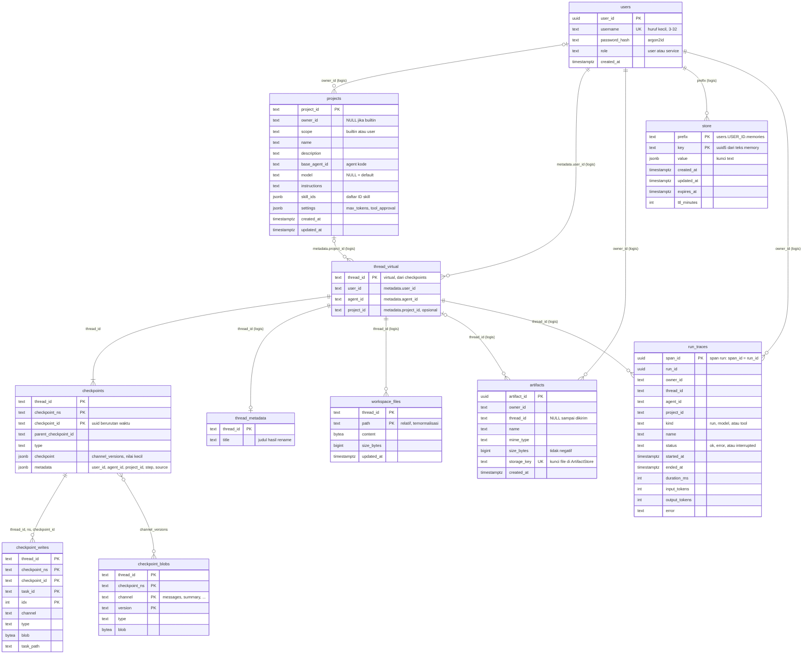
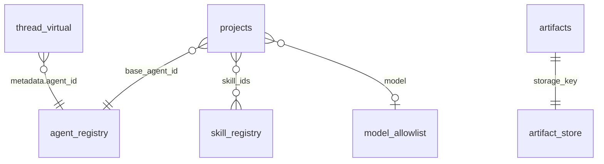

# Model Data (ERD)

Dokumen ini menjelaskan semua data yang disimpan service di Postgres per `v0.7.0` (sampai F38):
tabel, relasi, kardinalitas, siapa yang menjaga integritasnya, dan apa yang terjadi saat data
dihapus. Cara kerja komponen yang menulis data ada di [ARCHITECTURE.md](ARCHITECTURE.md), dan
alasan Postgres-only ada di [ADR 0001](adr/0001-postgres-only.md).

Sumber kebenaran skema:

- Tabel aplikasi: `src/agent_service/memory/tables.py` + revisi Alembic di
  `src/agent_service/memory/migrations/versions/` (`0001`–`0007`).
- Tabel LangGraph: dibuat `AsyncPostgresSaver.setup()` (checkpoint) dan
  `AsyncPostgresStore.setup()` (store) saat `run_migrate`, bukan oleh Alembic.

## Prinsip Desain

1. **Tidak ada foreign key di database.** Semua relasi bersifat logis dan ditegakkan di kode
   aplikasi (repository dan service). Alasannya:
   - **Thread bukan tabel.** Thread adalah kumpulan baris `checkpoints` dengan `thread_id` yang
     sama, jadi tidak ada baris induk yang bisa dirujuk FK.
   - **`owner_id` adalah klaim `sub` token**, bukan FK ke `users`. Kepemilikan tetap berlaku untuk
     service account dan akun yang dihapus (lihat komentar di `tables.py`).
   - **Tabel LangGraph tidak boleh diubah skemanya** oleh aplikasi, karena dimigrasi oleh library.
2. **Kepemilikan dicek di setiap baca/tulis** (NFR-9). Resource milik user lain dijawab 404, bukan
   403, supaya keberadaannya tidak bocor.
3. **Penghapusan berantai dilakukan aplikasi.** `ThreadRepository._remove` dan
   `ProjectService.delete` menghapus data turunan secara eksplisit (lihat
   [Siklus Hidup Data](#siklus-hidup-data)).
4. **Isi percakapan hanya ada di checkpoint.** Tabel lain menyimpan metadata (judul, trace,
   artifact) dan tidak menggandakan isi pesan.

## Diagram

### Database

`thread` (huruf miring di penjelasan) adalah **entitas virtual**: tidak ada tabelnya, tetapi
menjadi poros hampir semua relasi. Garis dengan label `logis` berarti relasi tanpa FK.



Tabel administratif yang tidak digambar: `alembic_version` (revisi tabel aplikasi),
`checkpoint_migrations`, dan `store_migrations` (versi skema milik LangGraph).

### Referensi ke luar database

Beberapa kolom merujuk ke sesuatu yang **bukan tabel**:



| Rujukan | Ke mana | Divalidasi oleh |
|---|---|---|
| `projects.base_agent_id`, `metadata.agent_id` | Agent kode di `AgentRegistry` (`agents/catalog.py`) | `ProjectService._validate_agent` (422 jika tidak tersedia) |
| `projects.skill_ids[]` | Skill di `SkillRegistry` (`skills/builtin/<name>/SKILL.md`) | `ProjectService` (422 jika tidak dikenal) |
| `projects.model` | Allowlist `AVAILABLE_MODELS` | `ModelFactory.resolve_name` (422) |
| `artifacts.storage_key` | File di `ArtifactStore` (`ARTIFACT_DIR`, volume `artifacts`) | `ArtifactService` (tulis file dulu, lalu metadata) |

## Kamus Entitas

### `users` (F24, revisi `0002`)

Akun login. Dibuat hanya lewat CLI `manage create-user`, dan tidak ada endpoint untuk mengubah
atau menghapusnya.

| Kolom | Tipe | Aturan |
|---|---|---|
| `user_id` | UUID | PK. Menjadi klaim `sub` token dan nilai `owner_id`/`user_id` di tabel lain |
| `username` | TEXT | Unik, huruf kecil `[a-z0-9._-]`, 3–32 karakter |
| `password_hash` | TEXT | Hash argon2id. Password tidak pernah disimpan |
| `role` | TEXT | `CHECK role IN ('user', 'service')`. `service` untuk eval dan worker |
| `created_at` | TIMESTAMPTZ | Default `now()` |

### `projects` (F26, revisi `0003`)

Agent deklaratif ([ADR 0004](adr/0004-project-as-declarative-agent.md)).

| Kolom | Tipe | Aturan |
|---|---|---|
| `project_id` | TEXT | PK. ID built-in tetap (dari `BUILTIN_PROJECTS`), ID user dibuat service |
| `owner_id` | TEXT, nullable | `CHECK (scope = 'builtin') = (owner_id IS NULL)`. Index `projects_owner_id_idx` |
| `scope` | TEXT | `CHECK scope IN ('builtin', 'user')`. Built-in read-only (403) |
| `base_agent_id` | TEXT | Tidak bisa diubah setelah dibuat, karena thread menyimpan `agent_id` |
| `model` | TEXT, nullable | Kosong = model default service |
| `instructions` | TEXT | ≤ 8000 karakter (divalidasi schema) |
| `skill_ids` | JSONB | Array ID skill, maksimal 20 |
| `settings` | JSONB | `ProjectSettings`: `max_tokens`, `tool_approval` (`never`/`always`) |
| `created_at`, `updated_at` | TIMESTAMPTZ | Default `now()` |

### *thread* (entitas virtual)

Thread dibentuk oleh baris `checkpoints` dengan `thread_id` yang sama. Atributnya dibaca dari
`metadata` JSONB checkpoint, yang disalin LangGraph dari `RunnableConfig["metadata"]` di setiap
run (`service/thread_access.run_metadata`):

| Atribut | Sumber | Arti |
|---|---|---|
| `thread_id` | `checkpoints.thread_id` | ID dari client, atau UUID baru dari service |
| `user_id` | `metadata.user_id` | Pemilik, dari token. Dipakai `is_thread_owner` |
| `agent_id` | `metadata.agent_id` | Agent kode yang menjalankan thread |
| `project_id` | `metadata.project_id` | Hanya ada untuk thread di dalam project |
| judul | `thread_metadata.title`, atau pesan human pertama | Judul custom menang |
| `updated_at` | `checkpoint_id` terakhir | UUID berurutan waktu |

Listing thread (`ThreadRepository.list_threads`) membaca checkpoint input (`step = -1`) dengan
filter containment JSONB pada `metadata`, lalu mengecek ulang pemiliknya.

### `checkpoints`, `checkpoint_blobs`, `checkpoint_writes` (LangGraph, F23)

State graph per langkah, dikelola `AsyncPostgresSaver`. Skemanya milik library.

- **`checkpoints`**: satu baris per langkah graph. `checkpoint_ns` kosong untuk graph utama.
  `parent_checkpoint_id` membentuk rantai riwayat. Kolom `checkpoint` menyimpan versi setiap
  channel, dan `metadata` menyimpan atribut thread di atas.
- **`checkpoint_blobs`**: nilai channel yang besar, dirujuk lewat `(channel, version)` dari
  `checkpoint.channel_versions`. Satu blob bisa dipakai banyak checkpoint selama nilainya tidak
  berubah. Channel yang dipakai service:

  | Channel | Isi | Fitur |
  |---|---|---|
  | `messages` | Semua message LangChain thread | v1 |
  | `summary`, `summarized_through` | Ringkasan riwayat lama dan ID message terakhir yang diringkas | F29 |
  | `birthdate` | Data yang sudah divalidasi `interrupt-agent` | F16 |

  Penanda di `additional_kwargs` message ikut tersimpan di sini: `reasoning_content` (F19),
  `subagent` (F17), `artifacts` (daftar `ArtifactRef`, F35), dan `workspace_files` (F36).
- **`checkpoint_writes`**: tulisan tertunda per task, termasuk interrupt yang menunggu jawaban
  user (FR-12).

### `thread_metadata` (F18, revisi `0001`)

Judul custom hasil rename (FR-25). Metadata checkpoint tidak dirancang untuk diubah setelah ditulis,
jadi judul disimpan terpisah. Relasinya 1 thread ↔ 0..1 baris.

### `artifacts` (F35, revisi `0006`)

Metadata file. Isi file ada di `ArtifactStore`.

| Kolom | Tipe | Aturan |
|---|---|---|
| `artifact_id` | UUID | PK. ID yang bukan UUID dijawab 404 |
| `owner_id` | TEXT | Pengunggah atau pemilik thread. Index `artifacts_owner_id_idx` |
| `thread_id` | TEXT, nullable | Kosong setelah upload. Diisi saat artifact pertama kali dikirim di run, atau saat diterbitkan `share_file`. Satu artifact hanya untuk satu thread (409). Index `artifacts_thread_id_idx` |
| `name`, `mime_type` | TEXT | Nama disanitasi. Tipe dari upload |
| `size_bytes` | BIGINT | `CHECK size_bytes >= 0`, ≤ `ARTIFACT_MAX_BYTES` (413) |
| `storage_key` | TEXT | Unik. Kunci file di `ArtifactStore` |

### `workspace_files` (F36, revisi `0007`)

Virtual filesystem per thread. PK `(thread_id, path)`, jadi satu path hanya punya satu versi.
`path` relatif dan ternormalisasi (`normalize_workspace_path`), isi disimpan apa adanya sebagai
`BYTEA`, dan ukuran per file dibatasi `ARTIFACT_MAX_BYTES`. Folder yang dipakai service:

| Folder | Diisi oleh |
|---|---|
| `uploads/<nama>` | Salinan lampiran user saat run |
| `tool-outputs/<tool_call_id>.txt` | Output tool yang melebihi `TOOL_OUTPUT_MAX_TOKENS` |
| path lain | `write_file`/`edit_file` model, dan file baru dari sandbox (F37) |

Listing diurutkan dengan `COLLATE "C"` supaya urutannya stabil.

### `run_traces` (F31, revisi `0005`)

Satu baris per span. Span `run` mewakili satu run (`span_id = run_id`), sedangkan span `model` dan
`tool` adalah panggilan di dalamnya. Kolom `thread_id`, `agent_id`, dan `project_id` disalin
(denormalisasi) supaya trace bisa dibaca tanpa checkpoint. Prompt, jawaban, dan argumen tool tidak
disimpan. Index `run_traces_run_id_idx` melayani `GET /runs/{run_id}/trace`.

### `store` (LangGraph, F30)

Key-value milik `AsyncPostgresStore`. Service hanya memakai namespace
`("users", <user_id>, "memories")`, yang disimpan sebagai `prefix = "users.<user_id>.memories"`.
`key` adalah uuid5 dari teks memory (tanpa beda huruf besar-kecil), jadi menyimpan teks yang sama
menimpa baris yang sama. `value` berisi `{"text": ...}`. Maksimal 200 memory per user. Tabel
`store_vectors` belum ada karena store dibuat tanpa index embedding (menunggu F43).

## Relasi dan Kardinalitas

| Relasi | Kardinalitas | Kunci | Ditegakkan oleh |
|---|---|---|---|
| user → project | 1 : 0..N (built-in tanpa user) | `projects.owner_id` | `ProjectService.get_visible`, check constraint scope/owner |
| user → thread | 1 : 0..N | `metadata.user_id` | `is_thread_owner` di setiap route thread |
| project → thread | 0..1 : 0..N | `metadata.project_id` | `is_thread_owner` membandingkan `project_id` |
| thread → checkpoint | 1 : 1..N | `thread_id` | LangGraph |
| checkpoint → write | 1 : 0..N | `(thread_id, ns, checkpoint_id)` | LangGraph |
| checkpoint ↔ blob | N : M | `channel_versions` | LangGraph |
| thread → judul custom | 1 : 0..1 | `thread_id` | `ThreadMetadataRepository` |
| thread → file workspace | 1 : 0..N | `thread_id` | `HarnessContext` (thread dari config service, bukan dari model) |
| thread → artifact | 0..1 : 0..N | `artifacts.thread_id` | `ArtifactService.link` (409 untuk thread lain) |
| user → artifact | 1 : 0..N | `artifacts.owner_id` | Semua query artifact disaring `owner_id` |
| user → memory | 1 : 0..200 | `store.prefix` | `UserMemoryRepository` (prefix dicocokkan per elemen) |
| user / thread / project → span | 1 : 0..N | kolom salinan di `run_traces` | `RunTraceRepository` (disaring `owner_id`) |
| run → span | 1 : 1..N | `run_traces.run_id` | `RunTraceCollector` |

## Siklus Hidup Data

### Penghapusan

```text
DELETE /threads/{id}  (atau route agent/project)
  └─ ThreadRepository._remove(thread_id)
       ├─ checkpointer.adelete_thread   → checkpoints, checkpoint_blobs, checkpoint_writes
       ├─ thread_metadata.delete        → thread_metadata
       ├─ ArtifactService.delete_thread_data → artifacts (baris) + file di ArtifactStore
       └─ PostgresWorkspace.delete_thread_data → workspace_files

DELETE /projects/{id}
  ├─ ThreadRepository.delete_project_threads → _remove(...) untuk setiap thread project milik user
  └─ ProjectRepository.delete         → projects

DELETE /artifacts/{id}   → satu baris artifacts + filenya
DELETE /memories/{id}    → satu baris store
```

Setelah thread dihapus, `/history` menjawab 404 dan `thread_id`-nya boleh dipakai ulang.

### Data yang tidak ikut terhapus

| Data | Kondisi | Dampak |
|---|---|---|
| `run_traces` | Thread atau project dihapus | Span tetap ada dan masih bisa dibaca pemiliknya lewat `run_id`. Belum ada retensi |
| `artifacts` dengan `thread_id` kosong | Di-upload tetapi tidak pernah dikirim | Baris dan file tetap ada sampai dihapus manual (`DELETE /artifacts/{id}`). Belum ada pembersihan otomatis |
| Semua data milik user | Akun dihapus langsung di database | Tidak ada endpoint hapus user. Data dengan `owner_id` itu menjadi yatim. Token yang sudah terbit tetap berlaku sampai kedaluwarsa |
| `store` | Thread dihapus | Memory memang lintas thread, jadi tidak ikut dihapus (sesuai desain F30) |

## Tabel yang Direncanakan

Revisi berikutnya akan menambah tabel berikut (detail di [ROADMAP](ROADMAP.md)):

| Tabel | Fitur | Relasi utama |
|---|---|---|
| `job_runs` | F41 | Unik `(job_id, window_start)`. Satu run menghasilkan satu thread di project job |
| `documents`, `chunks` (pgvector) | F43 | Dokumen milik project, chunk milik dokumen. Menghapus dokumen menghapus chunk |
| `ingestion_tasks` | F43 | Antrian per dokumen (`FOR UPDATE SKIP LOCKED`) |

Saat tabel baru ditambahkan, perbarui diagram, kamus entitas, tabel relasi, dan alur penghapusan di
dokumen ini dalam PR yang sama.
